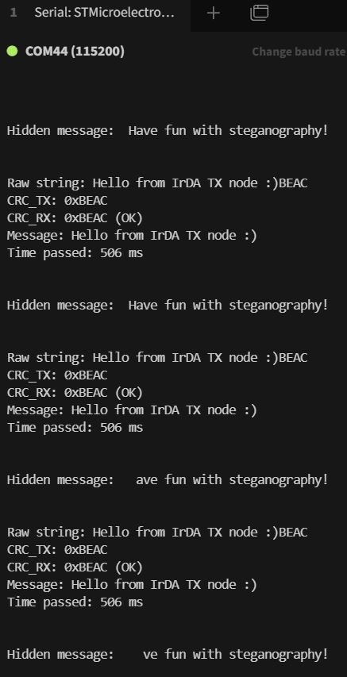

# IrDA (Infrared Data Association) SIR (Serial/Slow/Standard Infrared) steganography demo [STM32G431KB]

In this repo the RX part is demonstrated. The accompanying TX node and some readings are available [here](https://github.com/ufnalski/irda_steganography_tx_node_l432kc).

> [!NOTE]
> The IrDA signal is fed additionally to TIM IC (input capture)[^1] pin. The UART IrDA peripheral reads the official communication channel, whereas TIM IC peripheral reads the hidden communication channel.

[^1]: Another example of TIM IC application to infrared (IR) signals: [NEC IR remote control](https://github.com/ufnalski/ir_nec_remote_control_g431kb).

# Missing files?
Don't worry. Just open the .ioc file in STM32CubeMX and hit the GENERATE CODE blue bar. Then open the project in STM32CubeIDE for Visual Studio Code and build it.

# Call to action
Create your own [home laboratory/workshop/garage](http://ufnalski.edu.pl/control_engineering_for_hobbyists/2026_festiwal_nauki/Festiwal_Nauki_2026.pdf)! Get inspired by [ControllersTech](https://www.youtube.com/@ControllersTech), [DroneBot Workshop](https://www.youtube.com/@Dronebotworkshop), [Andreas Spiess](https://www.youtube.com/@AndreasSpiess), [GreatScott!](https://www.youtube.com/@greatscottlab), [bitluni's lab](https://www.youtube.com/@bitluni), [ElectroBOOM](https://www.youtube.com/@ElectroBOOM), [Phil's Lab](https://www.youtube.com/@PhilsLab), [atomic14](https://www.youtube.com/@atomic14), [That Project](https://www.youtube.com/@ThatProject), [Paul McWhorter](https://www.youtube.com/@paulmcwhorter), [Max Imagination](https://www.youtube.com/@MaxImagination), [Nikodem Bartnik](https://www.youtube.com/@nikodembartnik), [Stuff Made Here](https://www.youtube.com/@StuffMadeHere), [Mario's Ideas](https://www.youtube.com/@marios_ideas), [Aaed Musa](https://www.aaedmusa.com/), [Haase Industries](https://www.youtube.com/@h1tec), [Marcin Plaza](https://www.youtube.com/MarcinPlaza), [Predictable Designs with John Teel](https://www.youtube.com/@PredictableDesigns), [Mr Carlson's Lab](https://www.youtube.com/@MrCarlsonsLab), [Piotr Gorecki](https://www.youtube.com/@piotrgorecki_ZE), and many other professionals and professional hobbyists sharing their awesome projects and tutorials! Shout-out/kudos to all of them! Promote [README-driven learning](https://pe.org.pl/wp-content/uploads/2026/06/10_15199_48_2026_06_9.pdf).

> [!WARNING]
> Steganography - do try this with your spouse :grey_exclamation:

230+ challenges to start from: [Control Engineering for Hobbyists at the Warsaw University of Technology](http://ufnalski.edu.pl/control_engineering_for_hobbyists/Control_Engineering_for_Hobbyists_list_of_challenges.pdf).

Stay tuned!

0xBU
